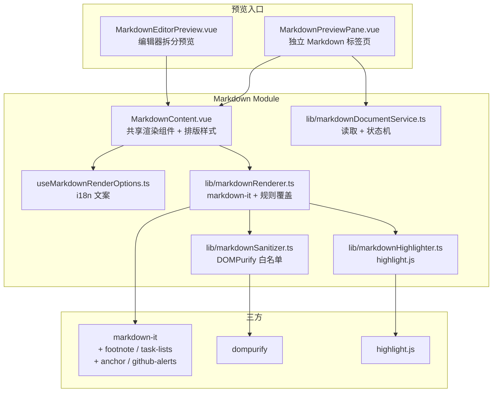

# Markdown 模块详细设计

## 架构设计

### 整体架构



### 数据流

1. **文件打开**：文件路径 -> `readMarkdownDocument` -> 读文件 / 判二进制 / 判大小 -> `ready`。
2. **渲染**：Markdown 文本 -> markdown-it 解析 -> 规则覆盖（link / image / fence）->
   DOMPurify 净化 -> `v-html`。
3. **交互**：代码块复制（事件委托 -> `writeClipboardText`）、
   外链点击（拦截导航 -> `openExternalUrl` 交给系统浏览器）。

## 数据结构

### 文档状态

```typescript
type MarkdownDocumentState =
  | { status: "loading" }
  | { status: "ready"; content: string; size: number }
  | { status: "binary"; size: number }
  | { status: "toolarge"; size: number; limit: number }
  | { status: "error"; message: string };
```

### 渲染参数

```typescript
interface MarkdownRenderOptions {
  copyLabel?: string;
  alertTitles?: Partial<Record<MarkdownAlertType, string>>;
}
```

解析器实例按文案签名缓存（`copyLabel` + `alertTitles`），语言切换时换实例，
其余情况复用同一个 markdown-it 实例。

## 算法逻辑

### Markdown 解析

markdown-it 配置：

| 选项 | 值 | 原因 |
|---|---|---|
| `html` | `true` | 原始 HTML（居中徽章、`details`）要能渲染，安全性交给净化层 |
| `linkify` | `true` | 裸 URL / 邮箱自动链接，与 GitHub 一致 |
| `typographer` | `false` | GitHub 不做智能引号转换 |
| `breaks` | `false` | 单换行不转 `<br>` |

插件：footnote / task-lists（`enabled: false` -> 复选框只读）/ anchor（GitHub 风格
slug，保留 CJK）/ github-alerts。

### 规则覆盖

| 规则 | 覆盖内容 |
|---|---|
| `link_open` | 协议白名单外的 href 整个剥掉（保留链接文字）；http(s) 补 `target` / `rel` |
| `image` | `data:` 图片白名单；协议白名单外的图片换占位符；填 `alt`；`loading="lazy"` |
| `fence` | 代码块外层容器 + 语言标签 + 复制按钮；未知语言退回纯文本 |

### 安全处理

三层防线，任何一层失效都还有下一层兜底：

1. **解析层**：`md.validateLink` 放行（解析期不判协议）——链接文字保留、href 落空，
   与 GitHub 一致；真正的协议判断在渲染层。
2. **渲染层**：
   - `isSafeHref`：只允许 http/https/mailto/ftp/ftps/tel 与相对路径；
     `DANGEROUS_HREF_LEADING_RE` 拦掉被前导空白 / 控制字节伪装的 `javascript:` 等。
   - `isSafeDataImageHref`：`data:` 只允许 `data:image/*;base64,...` 整体匹配。
3. **净化层**：DOMPurify 白名单 —— 标签集 / 属性集 / URI 正则三层过滤；
   `FORBID_CONTENTS` 让 `script` / `style` / `iframe` 连内容一起清掉；
   `ALLOW_DATA_ATTR` 放行 `data-md-copy` 这类自有标记。
   **失败关闭**：`DOMPurify.isSupported === false`（非 DOM 环境）时整段转义。

### 排版

排版全部在 `MarkdownContent.vue` 的 `<style scoped>` + `:deep()` 里，两处预览入口共用：

- 标题：h1/h2 带 `border-bottom` 分隔线，字号按 GitHub 的 2em / 1.5em / 1.25em 阶梯。
- 代码：行内码与代码块**无边框**，只有浅底 + 圆角；代码块右上角浮出语言标签与
  复制按钮（悬停 / 聚焦才出现，与 GitHub 渲染态一致）。
- 表格：`display: block; width: max-content; max-width: 100%`，表头浅底 + 斑马纹。
- 颜色全部走应用令牌（`--markdown-link` / `--markdown-code-bg` /
  `--markdown-table-head-bg`），高亮 token 复用 `code-highlight.css` 的 `--tok-*`，
  不另立调色板；圆角一律用 `--radius-*` 档位。

## 性能考虑

- 解析器实例缓存：同一语言下复用同一个 markdown-it 实例。
- highlight.js 只注册 29 个常用语言；语言未知时不做自动探测（避免误判与开销）。
- 渲染栈由 Vite 拆成独立的 `markdown-vendor` chunk，不进主包。

## 测试策略

### 单元测试

- `lib/markdownRenderer.test.ts`（jsdom 环境）：
  - 基础块级 / 行内渲染、GitHub 风格原始 HTML 渲染。
  - 安全：`onerror` / `script` 被净化、危险协议被剥 href、`data:` 图片白名单。
  - GFM 特性：表格、任务列表、脚注、alert、标题锚点。
  - 代码块：高亮、语言标签、复制控件、未知语言降级、内容转义。

### 组件测试

- `MarkdownContent.vue.test.ts`：渲染、属性透传、复制委托、外链拦截。
- `MarkdownPreviewPane.vue.test.ts`：文件状态机与渲染。

## 相关文件

- 前端：`src/modules/markdown/`、`src/modules/editor/MarkdownEditorPreview.vue`
- 解析器：`markdown-it` + 4 个插件
- 净化：`dompurify`
- 高亮：`highlight.js`
- 文件操作：`@/lib/native`
