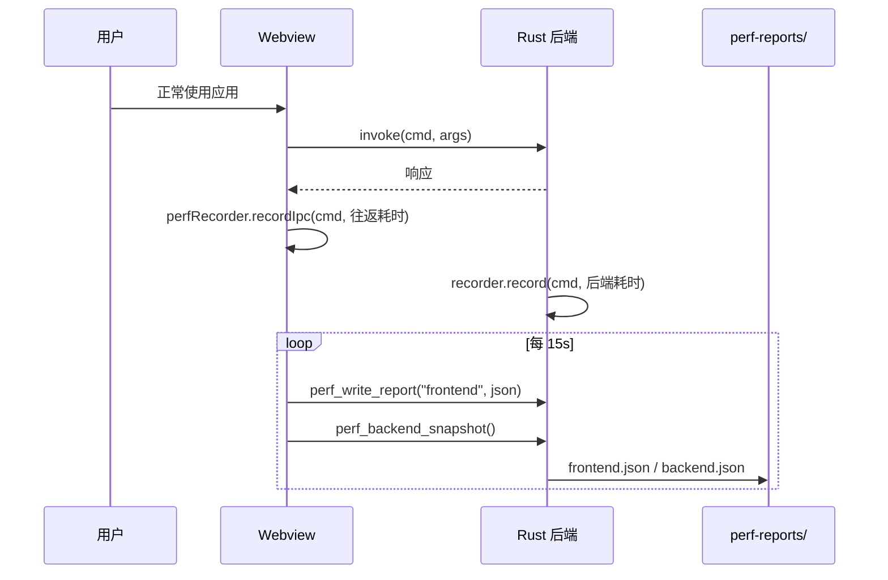

# 性能监控与录制（perf）

> 采集"应用真实使用过程"里的性能数据，产出可比较、可回归的报告，为后续性能优化提供依据。

## 1. 概述

本模块提供一条闭环工具链：

```
tools/perf/record.mjs  →  以录制态启动 Nexterm + 旁路采样 OS 指标
        ↓
src/modules/perf/*     →  前端采集：IPC 往返 / 长任务 / 帧率 / 内存 / 启动
src-tauri/src/modules/perf/*  →  后端采集：命令耗时
        ↓
perf-reports/<会话>/   →  frontend.json + backend.json + os-samples.csv
        ↓
tools/perf/analyze.mjs →  report.md（人读结论） + summary.json（机器可读）
```

**默认关闭**：不携带 `NEXTERM_PERF_DIR`（或 `--perf-dir=`）启动时，前端不采集任何数据，后端不计时，生产行为与之前完全一致。

## 2. 目录与文件

```
src/modules/perf/
  perfTypes.ts        报告数据契约（前后端 + 分析脚本三方共享）
  perfRecorder.ts     采集核心：环形缓冲 + 流式分位数聚合
  perfProbes.ts       浏览器探针：longtask / LCP / CLS / event / rAF / 内存
  perfIpc.ts          invoke 计时包装（不直接 import @tauri-apps/api/core）
  perfSession.ts      会话生命周期：boot / 定时 flush / 退出兜底 flush
  perfRecorder.test.ts / perfIpc.test.ts

src-tauri/src/modules/perf/
  mod.rs              会话配置、报告落盘、三个 Tauri 命令
  recorder.rs         后端命令耗时聚合 + 计时辅助（timed / timed_async）

tools/perf/
  record.mjs          录制主脚本（启动 / 采样 / 收尾）
  analyze.mjs         报告分析 CLI
  lib/osSampler.mjs   进程级 OS 指标采样（Windows PowerShell / POSIX ps）
  lib/analyze.mjs     汇总逻辑（供 record.mjs 与 analyze.mjs 共用）
```

## 3. 依赖

### 3.1 内部依赖

- `src/lib/native.ts` -- 唯一的 IPC 出口；perf 只经由它访问后端
- `src/lib/perf.ts` -- 已有 dev 计数器，录制时转发给 `perfRecorder`
- `src/modules/workspace/workspaceEnvSnapshot` -- `WorkspaceEnv` 类型（间接）

### 3.2 外部依赖

无新增 npm 依赖。浏览器侧只用标准 `PerformanceObserver` / `requestAnimationFrame` / `performance.memory`（后两者做能力探测）。

## 4. 数据契约

### 4.1 公共类型

见 `src/modules/perf/perfTypes.ts`。要点：

- `FrontendReport` -- IPC 聚合 + 最慢单次调用 + 长任务 + 帧桶 + 内存采样 + 启动打点 + 计数器
- `BackendReport` -- 后端命令聚合（Rust 侧 `#[serde(rename_all = "camelCase")]` 对齐）

### 4.2 Tauri 命令

| 命令 | 参数 | 返回 | 说明 |
|------|------|------|------|
| `perf_config` | — | `{ enabled, sessionId }` | 是否处于录制态。**不回传目录路径** |
| `perf_write_report` | `kind: "frontend" \| "backend"`, `content: string` | 文件名 | 落盘到会话目录；文件名白名单，内容 ≤16MB |
| `perf_backend_snapshot` | — | `BackendReport` | 后端命令耗时快照 |

### 4.3 事件

无。采集是拉取式（前端定时 flush），不新增 Tauri 事件。

## 5. Pinia 状态

无。采集器是普通单例（`perfRecorder`），不进入 Pinia：它是纯诊断数据，不参与业务状态流。

## 6. 关键算法 / 数据流



- **前端往返耗时** = 发起 → 响应抵达（含 IPC 与序列化）。
- **后端耗时** = 命令体实际执行时间（git 域在 `git_command!` 宏里统一埋点，fs/pty/lsp 挑慢路径命令埋点）。
- 两者差值大 → 载荷/序列化或排队是瓶颈；差值小 → 后端逻辑是瓶颈。

流式分位数：每个命令最多保留 1024 个耗时样本，超出后按 1/2 降采样（保留偶数位），内存占用与录制时长无关，代价是分位数变近似值。

## 7. 配置项

| 名称 | 位置 | 默认 | 说明 |
|------|------|------|------|
| `NEXTERM_PERF_DIR` | 进程环境变量 | 无 | 性能报告输出目录；设置即进入录制态 |
| `--perf-dir=<目录>` | 命令行参数 | 无 | 同上，优先级低于环境变量 |
| `FLUSH_INTERVAL_MS` | `perfSession.ts` | 15000 | 自动落盘间隔 |
| `MAX_DURATION_SAMPLES` | `perfRecorder.ts` / `recorder.rs` | 1024 | 单命令保留的耗时样本数 |
| `MAX_REPORT_BYTES` | `perf/mod.rs` | 16MB | 单份报告大小上限 |

## 8. 测试

- `src/modules/perf/perfRecorder.test.ts` -- 聚合、分位数、降采样、环形缓冲上限、开关语义
- `src/modules/perf/perfIpc.test.ts` -- 关闭态透传（含参数个数）、开启态计时与错误记录
- `src-tauri/src/modules/perf/mod.rs` -- 白名单拒绝穿越路径、未启用会话拒绝写入、只写会话目录
- `src-tauri/src/modules/perf/recorder.rs` -- 计数/错误/极值、降采样内存上限

## 9. 使用方式

```bash
# 一条命令完成：建目录 → 启动应用 → 采样 → 出报告
pnpm perf:record                    # 自动选择 dev / release
pnpm perf:record --mode=dev         # 开发模式
pnpm perf:record --label=git-heavy  # 给会话起名
pnpm perf:record --duration=120     # 采样 120 秒后收尾

# 事后重新分析
pnpm perf:analyze                          # 最近一次会话
pnpm perf:analyze perf-reports/20250101-120000-git-heavy
```

产物目录 `perf-reports/<会话>/`：

| 文件 | 内容 |
|------|------|
| `frontend.json` | 前端全量采样 |
| `backend.json` | 后端命令耗时 |
| `os-samples.csv` | 进程级 CPU / 内存 / 线程 / 句柄 |
| `report.md` | 人读报告（概览 + 结论 + 榜单） |
| `summary.json` | 机器可读汇总 |

> 原始数据目录已加入 `.gitignore`，不入库。

## 10. 安全边界

- `perf_write_report` 是 webview 可达的写文件 IPC，必须收口：
  - 仅在配置了会话目录时可用（否则直接报错）；
  - 文件名白名单 `frontend.json` / `backend.json`，**不接受任意路径**；
  - 内容大小上限 16MB；
  - 只回传文件名，不回传目录路径（不暴露宿主机目录结构）。
- 录制态由**启动进程的人**决定（环境变量 / 命令行参数），webview 无法自行开启。
- 后端计时有全局开关，关闭时只是一次原子读。

## 11. 已知盲区

- 未埋点的命令没有后端耗时，只有前端往返耗时（git 域已全量覆盖，fs/pty/lsp 覆盖慢路径）。
- `src/modules/lsp/manager.ts` 直连 `invoke`（IPC 边界白名单内的历史例外），其调用不计入 IPC 统计。
- 非 Chromium 内核（macOS WebKit）没有 `performance.memory`，内存章节只有 DOM 节点数。
